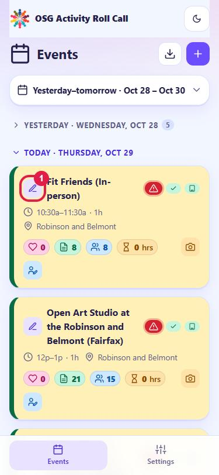
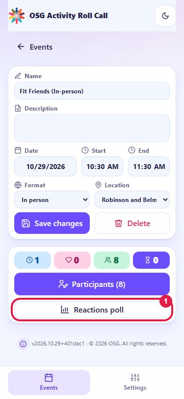
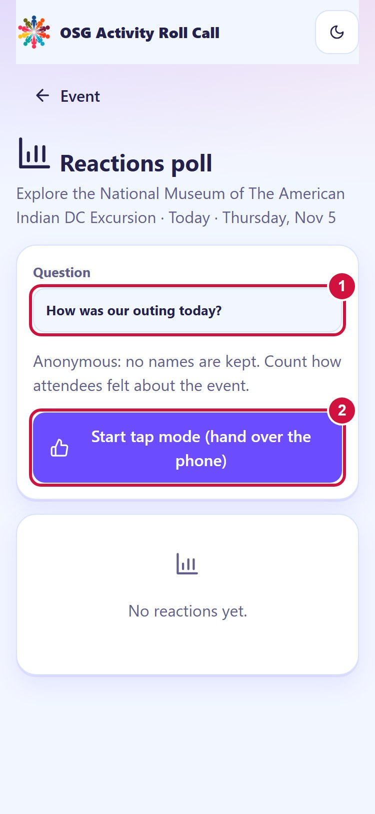
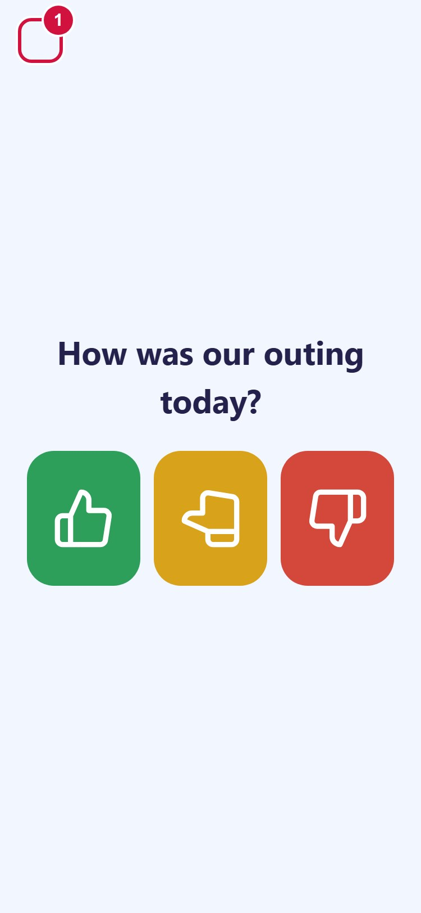
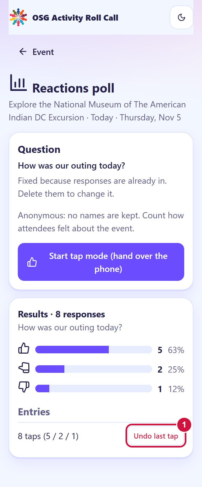

# Roll Call: Reactions poll guide

The Reactions poll is a quick, anonymous way to find out how an event went. At the end of an event, hand your phone around and let each attendee tap one button: 👍 great, 👌 okay, 👎 not good. No names are kept. Only the three totals are saved.

You can also **change the question** (new!). By default it asks "How was today's event?", but you can ask anything, for example "How was our outing today?".

## Step 1: Open your event

Tap **Events** (bottom left), find your event, and tap the **pencil icon** at the start of its card (red 1).

## Step 2: Open the Reactions poll

On the event page, at the bottom of the white card, tap the white **Reactions poll** button under the purple Participants button (red 1).

## Step 3: Set the question, then start

1. **Optional: change the question.** Tap the **Question** box (red 1), type your own question (up to 120 characters), and tap outside the box or press Enter on the keyboard. It is saved automatically. If you leave it alone, it asks "How was today's event?".
2. Tap the purple **Start tap mode (hand over the phone)** button (red 2).

**You can only change the question before the first response comes in.** Once someone has tapped, the question is locked so the results always match what people were asked. If you need to change it after that, delete the responses first (see "Fixed a mistake?" below).

## Step 4: Hand over the phone

The screen now shows your question with three big buttons. Hand the phone to an attendee. They tap one button, see "Thank you!", and the screen resets for the next person.

**To finish:** press and **hold the top-left corner** of the screen for about 1.5 seconds (red 1), then confirm **Finish polling**. This exit is invisible on purpose, so attendees can't leave the screen by accident.

## Step 5: See the results

Back on the poll page you will see the question, the number and percentage for each answer, and the total number of responses. The event page also shows a one-line summary.

### Fixed a mistake?

- Someone tapped the wrong button? Tap **Undo last tap** (red 1). Each tap removes the most recent response.
- Need a different question after responses are in? Tap **Undo last tap** until the results are empty. The Question box becomes editable again.

## Good to know

- **Anonymous:** no names or other details are recorded.
- **Weak signal is fine:** taps are saved on the phone and sent when you are back online.
- **Screen stays on** while tap mode is open.
- **Once everyone has responded:** if the event has a participant list, tap mode stops accepting taps when the number of responses matches the number of participants.
- **Results for several events:** go to **Report** and tap **Reactions CSV**. It includes the question for each event.

Questions? Message your coordinator.
